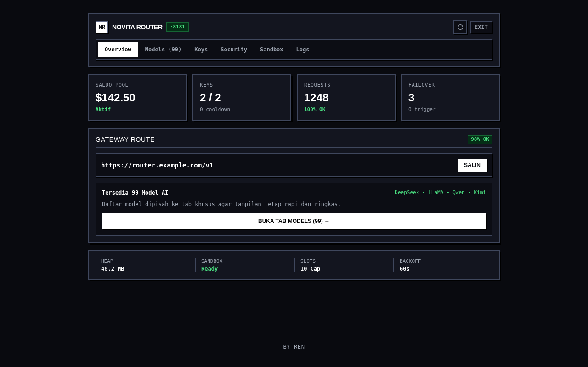

# Novita Router

[](LICENSE)
[](https://nodejs.org)
[](https://python.org)

[-ff70a6.svg)](https://instagram.com/rskl411_)

> OpenAI-compatible HTTP proxy, multi-key auto-failover pool, dan Cloud Code Sandbox gateway untuk Novita AI dalam satu daemon Node.js ringan tanpa dependensi framework eksternal.

---

## 🌐 Web Preview

### 🖥️ Control Center (Dark Calmed Neo-Brutalism)


---

## 🎯 Untuk Apa Project Ini Berjalan?

Integrasi langsung ke endpoint Novita AI sering terhambat beberapa kendala operasional di level produksi:
* **Single-Key Bottleneck**: Aplikasi klien akan langsung putus saat satu API key kena rate limit (`429`) atau saldo/kuota habis (`402`).
* **Eksposur Master Key**: Membagikan master key Novita ke banyak aplikasi atau agent berisiko membocorkan saldo utama dan menyulitkan audit penggunaan per klien.
* **Setup Terpisah untuk Sandbox**: Eksekusi kode terisolasi di microVM cloud memerlukan integrasi SDK Python terpisah dari endpoint LLM.

**Novita Router** menyatukan semuanya di satu gateway lokal:
1. **Transparent Multi-Key Failover**: Saat upstream membalas `429` atau `402` sebelum byte pertama dikirim, router otomatis menandai key bermasalah (cooldown 60 detik) dan me-retry payload ke key sehat berikutnya dalam hitungan milidetik.
2. **Managed Client API Keys (`nr_live_...`)**: Terbitkan, pantau hit counter, dan cabut API key klien kapan saja lewat dashboard tanpa mengekspos master key Novita.
3. **Unified LLM + Cloud Sandbox**: Melayani `/v1/chat/completions`, `/v1/models`, `/v1/embeddings` (termasuk SSE streaming), sekaligus `POST /api/sandbox/run` untuk eksekusi kode Python di microVM Novita.
4. **Zero Framework Bloat**: Backend murni menggunakan modul bawaan `node:http` dan `node:https` (~75 MB RAM) plus SPA Tailwind tanpa build step.

---

## ⚖️ Kelebihan & Kekurangan

| Kategori | Kelebihan (Pros) | Kekurangan (Cons) |
|---|---|---|
| **Arsitektur & Resource** | **Zero NPM Bloat**: Berjalan di native `node:http`/`https` dengan footprint ringan (~75 MB RAM) dan startup instan. | **Storage Flat-File JSON**: Konfigurasi (`keys.json`, `security.json`, `managed_keys.json`) disimpan di file lokal; tidak cocok untuk deployment multi-node terdistribusi tanpa shared volume. |
| **Reliabilitas Proxy** | **Pre-Byte Failover & Auto-Sync**: Deteksi `429`/`402`/`401` sebelum response dikirim ke klien, lengkap dengan sinkronisasi saldo tiap 2 menit. | **Single-Process Rate Limiter**: Counter rate limit disimpan in-memory, sehingga reset otomatis saat proses Node.js di-restart. |
| **Katalog & Integrasi** | **99+ Model Live & OpenAI-Compatible**: Kompatibel langsung dengan OpenAI SDK, Cursor, LangChain, atau bot CLI via `/v1/*`. | **Cloudflare WAF Upstream**: Permintaan upstream wajib mempertahankan header `User-Agent` CLI/browser agar tidak ditolak WAF Novita (Error 1010). |
| **Cloud Sandbox** | **MicroVM Terisolasi via REST API**: Eksekusi script Python langsung lewat endpoint `/api/sandbox/run` atau tab Sandbox di web UI. | **Dependensi Python Eksternal**: Fitur sandbox membutuhkan `python3` dan paket `novita-sandbox` terpasang di host. |

---

## ⚡ Architecture Overview

```text
  [ Client SDK / AI Agent / Browser ]
                  │
                  │ HTTP / HTTPS (Bearer nr_live_... atau Cookie Auth)
                  ▼
  ┌──────────────────────────────────────────────────────────┐
  │ Novita Router (:8181 — native node:http)                 │
  │                                                          │
  │  ├─ Security Gate  : IP Allowlist + In-Memory Rate Limit │
  │  ├─ Auth Layer     : Cookie / Bearer / Managed Key Pool  │
  │  ├─ OpenAI Proxy   : /v1/* + LRU Key Rotation & Failover │
  │  ├─ Model Catalog  : Live sync /v1/models (cache 10m)    │
  │  └─ Web UI         : public/index.html (SPA 6-Tab)       │
  └───────────────┬──────────────────────────┬───────────────┘
                  │ HTTPS + curl UA          │ child_process.spawn
                  ▼                          ▼
  ┌───────────────────────────┐  ┌───────────────────────────┐
  │ Novita AI Upstream API    │  │ run_sandbox.py            │
  │ (api.novita.ai/openai/v1) │  │ (novita-sandbox MicroVM)  │
  └───────────────────────────┘  └───────────────────────────┘
```

---

## 🚀 Cara Pakai & Tutor Deploy

### 1. Prasyarat Sistem
* **Node.js v18+**
* **Python 3.10+** (opsional, hanya dibutuhkan jika mengaktifkan fitur Cloud Sandbox)
* **PM2 & Nginx** (untuk deployment production dengan domain & SSL)

### 2. Setup Cepat (Lokal / Development)
```bash
# Clone repository
git clone https://github.com/rndsa/novita-router.git
cd novita-router

# Salin template konfigurasi (file asli otomatis di-ignore Git)
cp keys.example.json keys.json
cp security.example.json security.json
cp managed_keys.example.json managed_keys.json

# Install dependensi Sandbox (opsional)
pip install -r requirements.txt
```

Isi `keys.json` dengan minimal satu API key Novita AI milikmu, lalu ubah `adminPassword` dan `customToken` di `security.json`:
```bash
# Jalankan server di port 8181
PORT=8181 node server.js
```

### 3. Konfigurasi Environment Variables (Opsional)
| Variable | Deskripsi | Wajib? | Default |
|---|---|---|---|
| `PORT` | Port HTTP daemon lokal | Opsional | `8181` |
| `ROUTER_USER` | Username untuk HTTP Basic Auth | Opsional | `admin` |
| `ROUTER_PASS` | Password fallback admin (ditimpa `security.json`) | Opsional | `change-this-password` |
| `API_TOKEN` | Custom Bearer token untuk endpoint `/v1/*` | Opsional | `change-this-api-token` |
| `NOVITA_KEYS` | Daftar key Novita dipisahkan koma (alternatif `keys.json`) | Opsional | *(kosong)* |

### 4. Tutor Deploy Production (VPS Ubuntu + PM2 + Nginx + SSL)
```bash
# 1. Jalankan background daemon via PM2
pm2 start server.js --name novita-router
pm2 save
```

Buat virtual host Nginx (`/etc/nginx/sites-available/novita-router`) untuk mengarahkan domain ke port `8181` dengan buffering dimatikan agar SSE streaming lancar:
```nginx
server {
    listen 80;
    server_name router.domainlu.com;

    location / {
        proxy_pass http://127.0.0.1:8181;
        proxy_http_version 1.1;
        proxy_set_header Host $host;
        proxy_set_header X-Real-IP $remote_addr;
        proxy_set_header X-Forwarded-For $proxy_add_x_forwarded_for;
        proxy_set_header X-Forwarded-Proto $scheme;
        proxy_buffering off;
        proxy_cache off;
        proxy_read_timeout 300s;
    }
}
```

Aktifkan config Nginx dan pasang sertifikat HTTPS Let's Encrypt:
```bash
ln -s /etc/nginx/sites-available/novita-router /etc/nginx/sites-enabled/
nginx -t && systemctl reload nginx
certbot --nginx -d router.domainlu.com
```

Buka `https://router.domainlu.com` di browser, login dengan `adminPassword` dari `security.json`, lalu kelola key pool, IP allowlist, dan managed client keys langsung dari UI.

---

## 🛠️ Penggunaan via CLI / API

### 1. OpenAI SDK (Python)
```python
from openai import OpenAI

client = OpenAI(
    base_url="https://router.domainlu.com/v1",
    api_key="nr_live_..."  # Generate dari tab Keys di dashboard
)

res = client.chat.completions.create(
    model="deepseek/deepseek-v4.1-flash",
    messages=[{"role": "user", "content": "Ringkas arsitektur proxy dalam 1 kalimat."}]
)
print(res.choices[0].message.content)
```

### 2. Cloud Sandbox & Status via `curl`
```bash
# Cek status router dan saldo pool
curl -s https://router.domainlu.com/api/status \
  -H "Authorization: Bearer <ROUTER_PASS_OR_API_TOKEN>"

# Eksekusi kode Python di microVM Cloud Sandbox
curl -s -X POST https://router.domainlu.com/api/sandbox/run \
  -H "Authorization: Bearer nr_live_..." \
  -H "Content-Type: application/json" \
  -d '{"code": "import sys; print(sys.version)"}'
```

---

## 📄 Lisensi & Kontributor

* **Lisensi**: [MIT License](LICENSE)
* **Author**: [ren](https://instagram.com/rskl411_) • GitHub: [@rndsa](https://github.com/rndsa)
* Seluruh hak cipta dilindungi (c) 2026 ren.
